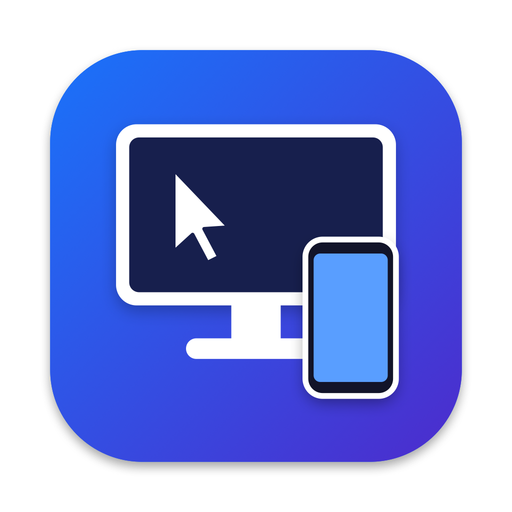
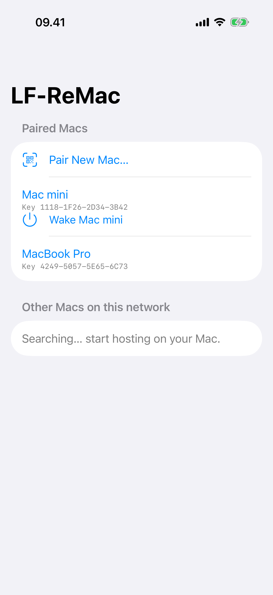
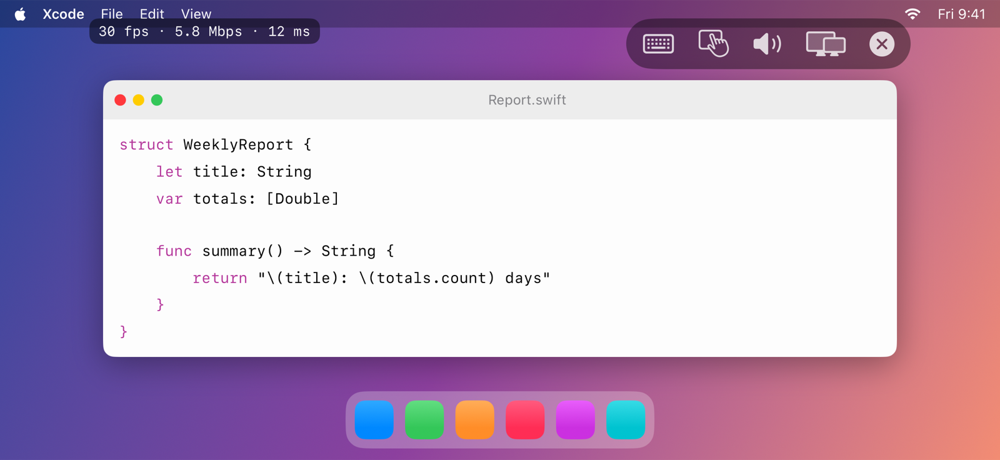
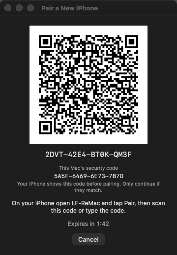
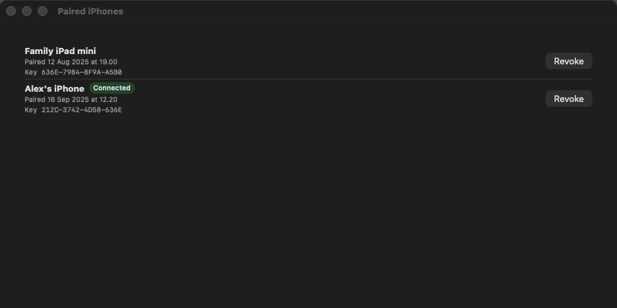

<p align="center">
  
</p>

<h1 align="center">LF-ReMac</h1>

<p align="center">
  A small, private remote desktop: control your Mac mini or MacBook from your iPhone.<br>
  No account, no cloud server, no third party in the middle.
</p>

LF-ReMac is two apps, both called LF-ReMac, that share one icon and one protocol:

- **LF-ReMac for Mac** (macOS 14+, the *host*): a menu bar app on the Mac. It captures the screen, encodes it with the
  hardware H.264 encoder and streams it to a paired iPhone.
- **LF-ReMac for iPhone** (iOS 17+, the *viewer*): the iPhone app. It shows the Mac's screen and sends touch and keyboard input back.

## Screenshots

<p align="center">
  
  &nbsp;&nbsp;
  
</p>

<p align="center">
  
  &nbsp;&nbsp;
  
</p>

<sub>The screenshots use made-up data (see [Regenerating the screenshots](#regenerating-the-icons-and-screenshots)).</sub>

## What it does

- **Private by design.** Pairing is a one-time QR code (or typed code) shown on the Mac. After that every
  connection is mutual TLS 1.3 with both sides pinned to each other's key. Only paired iPhones are answered,
  and the Mac accepts connections only from your local network (Tailscale is an opt-in setting).
- **Low-latency video.** ScreenCaptureKit, hardware H.264, 30 fps, adaptive bitrate. Frames are dropped
  rather than queued when the link is slow, so the picture stays current.
- **Touch and keyboard.** Trackpad mode or direct-touch mode, pinch to zoom, two-finger scroll, and an
  on-screen keyboard with modifier keys. Remote control is off on the Mac until you switch it on.
- **Several displays.** Pick which of the Mac's displays to stream; the choice is remembered per iPhone.
- **Sound.** Optional, off by default. The Mac's audio is sent as AAC and kept in step with the picture.
- **Wake-on-LAN.** Wake a sleeping Mac from the iPhone while you are on the same Wi-Fi network.
- **Keeps the Mac available.** Optionally stops the Mac from idle-sleeping while it is hosting.

For setup on a Mac that has to stay reachable (sleep settings, headless Mac mini and dummy plug, Tailscale,
sound), read [Keeping the Mac reachable](docs/hosting-the-mac.md). Performance notes are in
[docs/latency-tuning.md](docs/latency-tuning.md).

## Install

- **Mac app:** `brew install --cask alifu/tap/lf-remac` (macOS 14+). It is not notarized, so allow it once in
  System Settings → Privacy & Security; see [Installing LF-ReMac](docs/installing.md).
- **iPhone app:** build it from source and install it on your own iPhone (below). It is not on the App Store.

## Build and run

Everything is built from source; the Xcode project is generated by [XcodeGen](https://github.com/yonaskolb/XcodeGen).

1. Install the tools: `brew install xcodegen`.
2. Copy `Config/Local.xcconfig.example` to `Config/Local.xcconfig` and put your Apple team ID in it. A free
   Personal Team works; the apps then need re-signing from Xcode every 7 days.
3. Generate the project and open it: `xcodegen generate && open LF-ReMac.xcodeproj`.
4. Run the **MacHost** scheme on the Mac (it builds the Mac app *LF-ReMac*). Grant **Screen Recording** (and **Accessibility** if you want
   remote control) when asked, then choose **Start Hosting** in the menu bar item.
5. Run the **iOSClient** scheme on your iPhone, tap **Pair New Mac…** and scan the QR code from
   **Pair New iPhone…** on the Mac.

## Tests

```sh
(cd Packages/RemoteCore && swift test)
xcodebuild -scheme MacHost  -destination 'platform=macOS' test
xcodebuild -scheme iOSClient -destination 'platform=iOS Simulator,name=iPhone 17 Pro,OS=26.5' test
```

`Packages/RemoteCore` holds the code both apps share (wire protocol, security, pairing); the apps live in
`MacHost/` and `iOSClient/`.

## Regenerating the icons and screenshots

The icon is drawn by a script, and the screenshots come from UI automation against dummy data, so neither
needs a real Mac or iPhone connection:

```sh
swift Tools/make-icons.swift      # app icons for both apps + docs/images/app-icon.png
Tools/make-screenshots.sh         # docs/images/ios-*.png and mac-*.png
```

The screenshot mode (`-screenshots` launch argument) exists only in Debug builds. It uses an in-memory store
with invented Macs and iPhones and never starts the server, the capture or the Keychain.

## Status and credits

- **The iPhone app is not published.** It is built and signed with a **personal (free) Apple developer account**
  only. It is not on the App Store or TestFlight, so you build and install it yourself, and an app signed
  that way needs to be reinstalled from Xcode every 7 days. See [Installing LF-ReMac](docs/installing.md).
- **The Mac app is not notarized**, for the same reason (no paid Developer ID), and is distributed through a
  personal Homebrew tap rather than the official one.
- Made by [alifu](https://github.com/alifu). Built with Swift, SwiftUI, ScreenCaptureKit, VideoToolbox,
  Network.framework and [XcodeGen](https://github.com/yonaskolb/XcodeGen).
